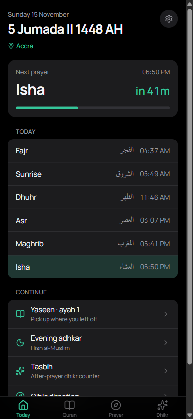
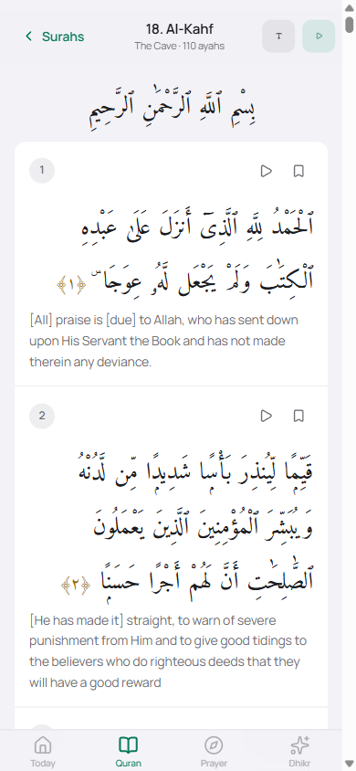
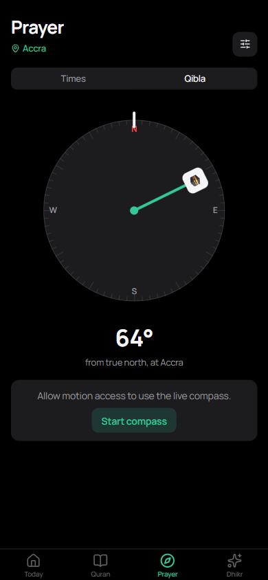
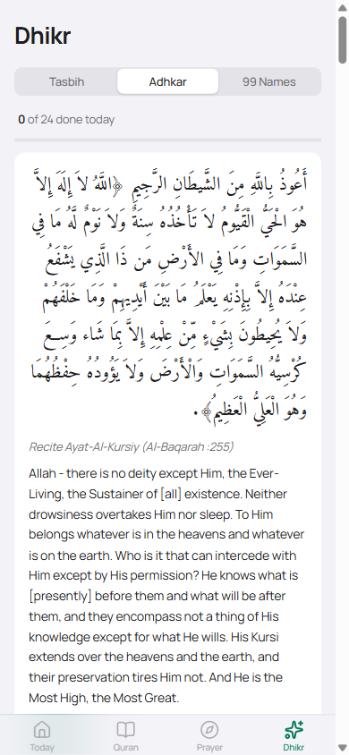
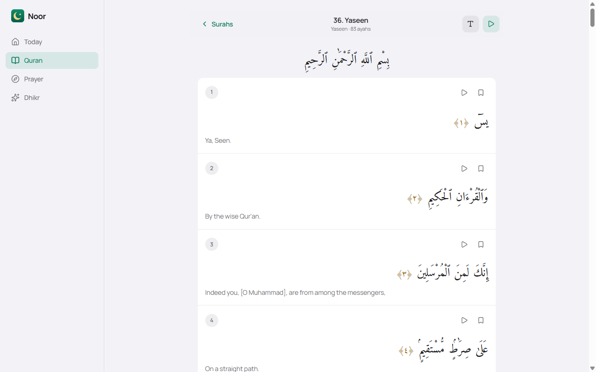

<div align="center">


# Noor

**Quran, prayer times, qibla and dhikr in one app that keeps working offline.**

[](https://github.com/ohenemanaf/IslamOS/actions/workflows/ci.yml)


[](LICENSE)

</div>

| Today (dark) | Quran reader | Qibla | Adhkar |
|---|---|---|---|
|  |  |  |  |

## Features

**Today**
- The next prayer with a live countdown, and all of today's times
- The Hijri date (Umm al-Qura calendar)
- Shortcuts to continue reading, to morning adhkar (after Fajr) or evening adhkar (after Asr), to the tasbih and to the qibla

**Prayer times and qibla**
- Prayer times are **calculated on the device**, so they need no internet. There are 11 calculation methods to choose from, and Asr can follow the standard or the Hanafi ruling.
- Location comes from GPS or from a built-in list of cities. It includes ten major Ghanaian cities and major cities in West Africa and abroad. Your location never leaves the device.
- The **live qibla compass** turns with the phone and tells you which way to turn. On iOS it asks for motion permission first. On desktop it shows the bearing instead.
- You can step through the days to see other days' times.

**Quran**
- All 114 surahs in the Uthmani script, with the Saheeh International English translation
- Recitation by Mishary Alafasy: tap play on one ayah, or play the whole surah continuously
- Bookmarks, and your reading position is saved automatically
- **Download for offline:** the full Quran uses about 1.5 MB of data and 4 MB on the device
- Adjustable Arabic text size, and the translation can be turned off

**Dhikr**
- **Tasbih counter** with haptic feedback, daily totals, and the after-prayer set (33 + 33 + 34), which moves to the next phrase on its own
- **Morning and evening adhkar** from *Hisn al-Muslim*, with repeat counts, daily progress and audio
- **The 99 Names of Allah**, searchable by Arabic, transliteration or meaning

**Everywhere**
- Light and dark themes, a 12- or 24-hour clock, and a phone layout with a desktop sidebar
- Installable as an app, and **offline-first**

<p align="center"></p>

## How offline works

| Content | Where it comes from | Offline behaviour |
|---|---|---|
| App code, fonts, icons | This app | Precached by the service worker on first visit |
| Prayer times, qibla, Hijri date | Calculated on the device ([adhan](https://github.com/batoulapps/adhan-js), `Intl`) | Always available |
| Quran text and translation | [AlQuran Cloud](https://alquran.cloud) | Each surah is saved the first time it's opened, or all at once with **Download** |
| Adhkar | [Hisn al-Muslim](https://www.hisnmuslim.com) | Saved after the first load |
| 99 Names | [Aladhan](https://aladhan.com) | Saved after the first load |
| Recitation audio | [Islamic Network CDN](https://islamic.network) | Needs internet |

Saved content is kept in its own cache, separate from the app's. Updating the app replaces the app code without deleting anything you've downloaded. Every page is bundled into a single file, so a tab left open across an update never asks for a file that no longer exists.

## Accuracy

- **Prayer times** are tested against [Aladhan](https://aladhan.com)'s API, the service the original IslamOS used. Makkah (Umm al-Qura method) matches to the minute; Accra (Muslim World League) is within one minute, because the two round differently.
- **The Hijri date** is tested against Aladhan's Umm al-Qura conversion.
- **The Bismillah:** this text edition starts ayah 1 of most surahs with the Bismillah. Noor removes it from the ayah and shows it once as a heading. This was checked against all 6,236 ayahs: exactly 112 ayahs change (every surah except Al-Fatiha and At-Tawbah) and nothing else is touched.
- **Arabic search and matching** compare letters only, ignoring vowel marks. The same word can store its marks in different orders, which would otherwise break exact matches.

## Getting started

```bash
npm install
npm run dev        # http://localhost:5173
npm test           # 17 unit tests (Vitest)
npm run build      # production build + service worker in dist/
npm run preview    # serve the build to try it offline
```

The service worker only exists in production builds. Use `npm run build && npm run preview` to test offline behaviour.

## Deploying

Noor is a static site with no backend.

- **Vercel:** import the repository; it detects Vite automatically. `vercel.json` makes sure `sw.js` is never cached by the browser, so updates reach users.
- **Netlify / GitHub Pages / any static host:** publish `dist/` after `npm run build`. Serve it over HTTPS, because service workers, GPS and the compass all require it.

## Project structure

```
src/
├── lib/
│   ├── prayer.js      # prayer times, next prayer, qibla, Hijri date (pure, tested)
│   ├── content.js     # Quran / adhkar / names fetch + cache, Bismillah handling (tested)
│   ├── compass.js     # device heading across iOS and Android
│   ├── cities.js      # preset locations
│   ├── settings.js    # persisted location, method and preferences
│   └── store.js       # localStorage hook, shared clock, hash router
├── components/        # UI kit, settings sheets
├── views/             # Today, Quran, Prayer, Dhikr
└── sw-template.js     # service worker (filled in at build time)
tests/                 # Vitest + real API fixtures
```

## History

Noor merges two earlier projects:

- **IslamOS**, the original version of this repository: a desktop-style "operating system" with windows, a dock and 13 mini-apps
- **Al-quran**: a stand-alone Quran reader with per-ayah audio and bookmarks

It keeps the parts people use daily, rebuilt mobile-first and offline-first. The old code is still in this repository's git history.

## Credits

The Quran text is the Tanzil Uthmani text, served by AlQuran Cloud, with the Saheeh International translation. Adhkar are from *Hisn al-Muslim* (Fortress of the Muslim) by Sa'id ibn Ali ibn Wahf al-Qahtani. Prayer calculations use [adhan-js](https://github.com/batoulapps/adhan-js) (MIT).

## License

The app's code is released under the [MIT License](LICENSE). The religious texts and recitations belong to their respective sources listed above.

## Author

**Abdul Manaf Ali** · [@ohenemanaf](https://github.com/ohenemanaf)
